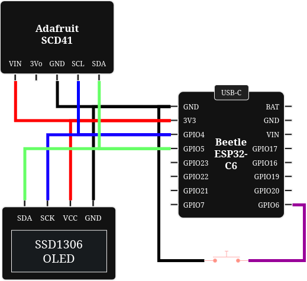
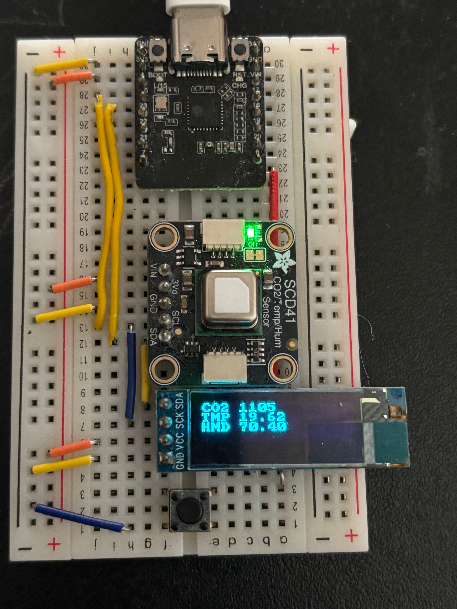

# Environment Monitor ESP32

This is a device that measure temperature, CO2 level, and humidity. 

It send the measurements to a Spring Boot server (Environment Monitor Server) and store the data in a PostgreSQL database. 

Wifi provisioning is implemented with Espressif's Network Provisioning library (SECURITY 2).

### Circuit Diagram

### Physical Prototype

Button is used to swap screen between wifi provision display and the measurement display.

#### Video

https://github.com/tranhqnhan/ENVIRONMENT-MONITOR-ESP32/docs/ems_monitor_work.mp4

### TODO

- Sends measurement data over HTTPS